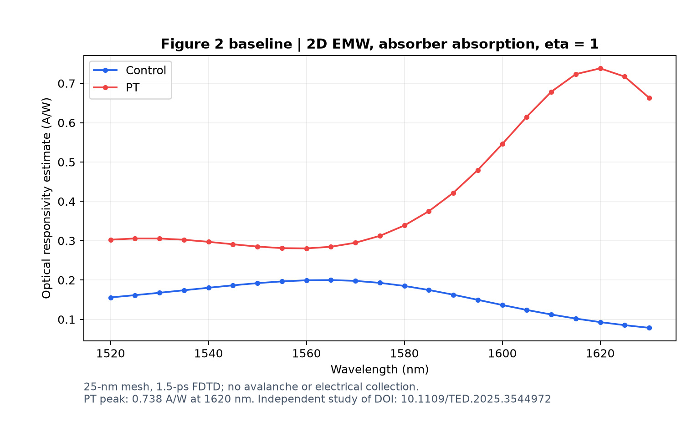
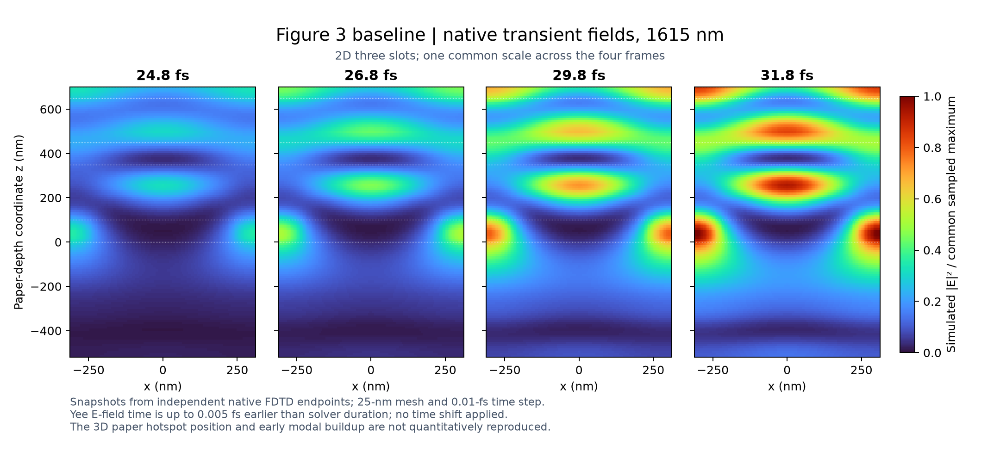
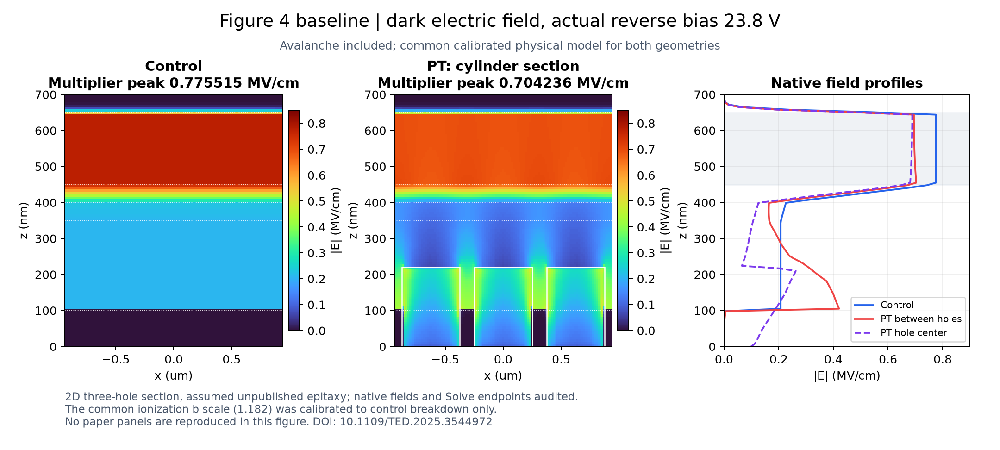
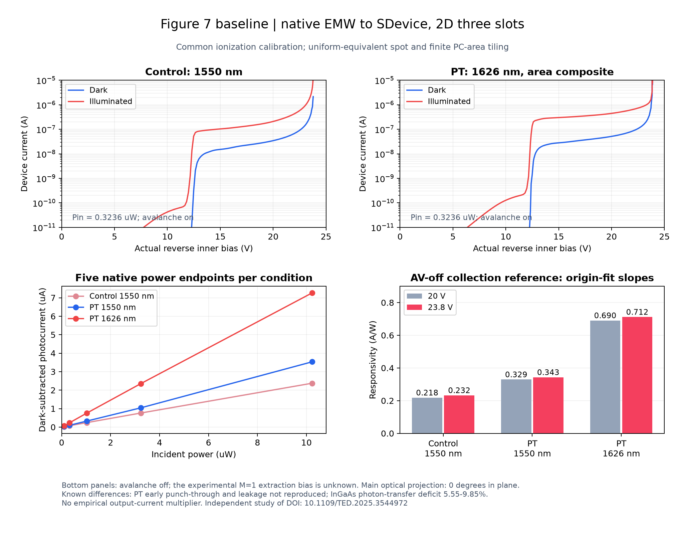

# Reproduction of “Efficient Responsivity Enhancement of Surface-Illuminated InGaAs Avalanche Photodiode by Photon Trapping on the SOI Substrate”

二维三孔截面的源工程、真实仿真结果与备份，覆盖 SDE 和论文 Figure 2、3、4、7。研究环境为 Sentaurus X-2025.06。**这是经过审核的二维基线，包含一次公共雪崩参数校准；尚未实现论文的完整定量复现。**

Paper: R. Shao et al., *Efficient Responsivity Enhancement of Surface-Illuminated InGaAs Avalanche Photodiode by Photon Trapping on the SOI Substrate*, IEEE TED 72(5), 2025. [DOI: 10.1109/TED.2025.3544972](https://doi.org/10.1109/TED.2025.3544972).

## 发布与备份

- `projects/`：Workbench 参数树、SDE / EMW / SDevice 输入、后处理 Tcl、真实 CSV、case map、运行身份和审核 JSON。
- `figures/`：仅由本次仿真数据绘制的公开预览，没有论文原图或曲线数字化数据。
- `docs/model_and_results.zh-CN.md`：结构假设、物理模型、尺度换算、校准与剩余误差。
- [Releases](../../releases/latest)：源文件 ZIP、包含原生网格和场/电流 TDR/PLT 的结果备份 ZIP、SHA-256 校验表。结果备份保留相同 `projects/` 目录，可在新目录解压检查。
- `PUBLICATION_MANIFEST.json`：公开文件的字节数和 SHA-256；`provenance/source_files.json` 记录原交付文件与公开文件哈希的对应关系。

**依照发布要求，材料参数文件与光学 n/k 表均已剔除。**完整厂商材料库、论文 PDF/原图、论文曲线数字化数据、完整运行日志和一次性启动器也不发布。原始本地工程保持原样。参见 [MATERIAL_INPUTS.md](MATERIAL_INPUTS.md) 与 [EXCLUSIONS.json](EXCLUSIONS.json)。因此公开工程可以审阅，绘图可以重做；缺少材料输入时不能独立重新求解。

## 已审核结果与差距

| 项目 | 论文目标 | 二维结果 | 解释 |
|---|---:|---:|---|
| Fig.2 PT 光谱峰 | 0.870 A/W @ 1615 nm | 0.738 A/W @ 1620 nm | 25 nm 网格统一光谱；20 nm 仅检查六个选点 |
| Fig.4 控制器件倍增层峰值电场 | 0.730 MV/cm | 0.775515 MV/cm | 真反偏 23.8 V，含雪崩，+6.24% |
| Fig.4 圆柱孔器件倍增层峰值电场 | 0.682 MV/cm | 0.704236 MV/cm | 同一物理模型，+3.26% |
| Fig.7 控制器件 1550 nm | 0.30 A/W | 0.232377 A/W | 23.8 V，关闭雪崩的收集参考，五个真实功率点过原点拟合 |
| Fig.7 PT 1550 nm | 0.39 A/W | 0.342816 A/W | 同上；功率非线性相对拟合最大约 16.3% |
| Fig.7 PT 1626 nm | 0.75 A/W | 0.711609 A/W | 同上 |

Fig.3 保留 24.8 / 26.8 / 29.8 / 31.8 fs 的真实瞬态场及网格、时间步敏感性结果。早期模态建立更强、热点位置不同，不能称为空间场分布定量吻合。

Fig.7 的 PT 提前贯穿约 4 V **尚未得到**，主上升仍约 13 V。控制/PT 暗电流在论文 90% 击穿偏压处约 55.97 / 78.73 nA，论文约 16.9 / 51.3 nA。控制器件约 24 V 击穿参与了校准；本研究采用的 10 µA 暗电流击穿代理值约 23.83 V，不是独立预测。PT 台面拼合曲线也受未刻孔台面主导，不能把局部孔截面的约 25.85 V 代理值当成整器件击穿。

校准仅将 InAlAs 及渐变层的电子、空穴雪崩指数场参数统一乘以 1.182，以控制器件击穿为唯一锚点。全部几何共用；未对输出电流乘经验因子，未平移电压轴或混接不同物理模型。

主要限制：二维槽代替三维孔阵列；缺失外延、寿命和界面取假设；10° 实验入射的方位未给出，主曲线统一采用零面内投影；光生张量场导入有限元后 InGaAs 积分低约 5.55–9.85%，未用倍率补偿。所有记录中 `quantitative_paper_reproduction_achieved` 保持 `false`。

## 预览









## 使用公开快照

```text
python -m pip install -r requirements.txt
python tools/verify_snapshot.py
python tools/plot_results.py
python tools/prepare_local.py --output-root /path/to/new/shao2025_projects
```

`prepare_local.py` 只复制到不存在的目标目录并替换 `__PROJECT_ROOT__`，不会启动仿真。源文件中的 `__SENTAURUS_ROOT__` 须按安装位置设置。历史运行 JSON 是身份和审核记录，不能直接当作新一轮提交清单；其中历史源哈希可能指向被剔除的材料文件或脱敏前的路径，公开完整性以本快照清单为准。

解压 Release 的完整结果备份后，可运行 `python tools/verify_snapshot.py --with-native` 同时核对原生文件。`NATIVE_MANIFEST.json` 也在仓库中列出备份文件和哈希，源文件包不含这些二进制。

在合法 Sentaurus 环境中补齐材料输入后，通过 Workbench 依次处理：原 SDE → Fig.2 光学网格/光谱 → Fig.3 瞬态 → Fig.4 电学网格/电场 → Fig.7 EMW 光生与 SDevice 输运。通过 case map 选择节点，勿把历史节点编号视为所有版本的固定编号。Fig.3 需要相应 20/25 nm 网格；Fig.7 输运需要 Control/Slanted 电学网格与对应波长、角度的光生 TDR，结果备份中保留了这些文件。新的仿真仍须审核每个 Solve 终点、真实偏压、光生输入、有限值和电流守恒。

MIT 许可仅覆盖自有代码；第三方软件、材料库和论文不在授权范围。请引用原论文，并注明二维近似、材料输入未公开和校准/误差。详见 [THIRD_PARTY.md](THIRD_PARTY.md)。
